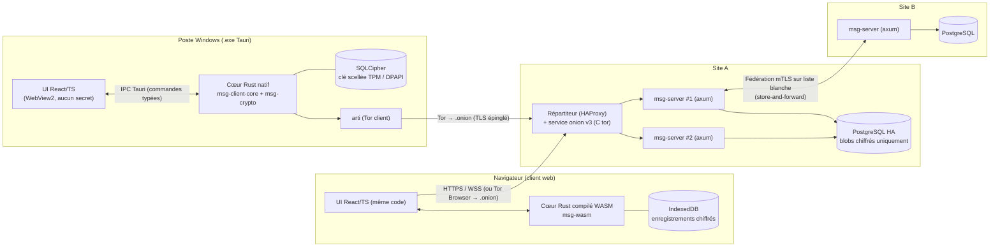

# 01 — Architecture et choix techniques

> Statut : **proposition Phase 0, en attente de validation**.
> Les décisions structurantes sont détaillées sous forme d'ADR dans [`docs/adr/`](../adr/).

## 1. Vue d'ensemble



Principes :

1. **Un seul cœur cryptographique** en Rust, compilé en natif pour le desktop et en WebAssembly pour le web. Desktop et web parlent donc exactement le même protocole et sont interopérables par construction.
2. **Serveur « aveugle »** : il authentifie des appareils, route et stocke des blobs opaques (messages MLS, pièces jointes chiffrées, paquets de clés publiques). Il ne possède aucune clé permettant de déchiffrer.
3. **Sur le desktop, aucun secret ne vit dans la WebView** : la couche JavaScript n'appelle que des commandes de haut niveau (`send_message`, `list_conversations`…) et reçoit du texte déjà déchiffré à afficher. Les clés restent dans le processus Rust.
4. **Fédération explicite** : chaque site possède son propre serveur, ses propres comptes (`alice@site-a`), et ne parle qu'aux sites présents dans sa liste blanche (clés publiques épinglées).

## 2. Stack retenue et justification

| Couche | Choix | Pourquoi | Écart vs stack suggérée |
|---|---|---|---|
| Cœur crypto | **Rust** + **OpenMLS 0.9** (fournisseur `openmls_libcrux_crypto`, repli `openmls_rust_crypto`) | Sécurité mémoire, `zeroize`, compile en natif **et** WASM ; OpenMLS est l'implémentation Rust de référence de RFC 9420, licence MIT | **Écart majeur** : MLS aussi pour le 1-à-1 au lieu du Signal Protocol — voir §3 et [ADR-0002](../adr/0002-mls-pour-tout.md) |
| Post-quantique | Suite MLS `MLS_256_XWING_CHACHA20POLY1305_SHA256_Ed25519` (X-Wing = ML-KEM-768 + X25519) | Disponible dans `openmls_libcrux_crypto` 0.4 (vérifié dans le code source) ; hybride, donc pas pire que X25519 seul | Remplace PQXDH. Limite : point de code **provisoire** (draft X-Wing 06), signatures Ed25519 non post-quantiques |
| Desktop | **Tauri v2** (2.12) | `.exe` léger (WebView2 système), backend Rust natif, bundler MSI (WiX) + NSIS intégré | Conforme |
| Frontend | **React 18 + TypeScript + Vite**, CSS local | Écosystème d'accessibilité mature (`react-aria`), un seul code UI desktop/web | Conforme (React plutôt que Svelte, pour l'accessibilité) |
| Serveur | **Rust / axum 0.8** + `sqlx` + **PostgreSQL 16** | Partage des types (`msg-proto`) avec le client, pas de GC, `tokio` mature | Conforme |
| Auth serveur | `argon2` (Argon2id), `totp-rs`, `webauthn-rs` 0.6 | Bibliothèques RustCrypto / auditées (webauthn-rs a été audité) | Conforme ; option OPAQUE proposée ([ADR-0007](../adr/0007-authentification.md)) |
| Key Transparency | **`akd`** (Auditable Key Directory, Meta, utilisé par WhatsApp) | Journal Merkle append-only vérifiable, preuves vérifiables côté client y compris en WASM | Conforme (bibliothèque existante plutôt qu'arbre maison) |
| BDD locale desktop | `rusqlite` + **SQLCipher** (feature `bundled-sqlcipher-vendored-openssl`) | Standard de facto, chiffrement de page AES-256 | Conforme |
| BDD locale web | IndexedDB, chaque enregistrement chiffré AES-256-GCM (RustCrypto) en WASM | SQLCipher n'existe pas dans le navigateur | Adaptation documentée |
| Protection de clé | Windows **CNG / Microsoft Platform Crypto Provider** (TPM 2.0) → repli **DPAPI** | La clé maîtresse locale est *scellée* par une clé RSA/ECDH non exportable du TPM | Voir limites : le TPM ne supporte pas Ed25519/X25519 |
| Tor client | **arti-client** (0.48) | Tor en Rust, embarquable, pas de processus externe | Conforme |
| Tor serveur | **C tor** pour héberger les services onion v3 (+ Onionbalance en HA) | L'hébergement de services onion dans arti reste moins éprouvé que C tor | Écart justifié ([ADR-0006](../adr/0006-tor.md)) |
| Format réseau | Protobuf (`prost`) pour l'API, messages MLS sérialisés TLS-codec (RFC 9420) | Schéma versionné, multi-langage, compact | — |
| Transport | HTTPS (rustls) + WebSocket ; TLS **épinglé** même au-dessus de Tor | Défense en profondeur | — |

## 3. Pourquoi MLS pour le 1-à-1 au lieu du Signal Protocol

La consigne propose Signal (X3DH/PQXDH + Double Ratchet) pour le 1-à-1 et MLS pour les groupes. **Je recommande MLS pour tout**, pour quatre raisons vérifiables :

1. **Licence** : `libsignal` est sous **AGPL-3.0**. Le dépôt est sous **MIT**. Embarquer libsignal imposerait de distribuer l'ensemble du client sous AGPL. OpenMLS est MIT.
2. **WASM** : libsignal n'est pas distribué sur crates.io et ne supporte pas officiellement `wasm32-unknown-unknown`. OpenMLS documente et teste la cible WASM. Or le critère « desktop ↔ web » impose le même code crypto des deux côtés. **Vérifié** : la sonde [`spikes/mls-xwing-wasm`](../../spikes/mls-xwing-wasm/) établit un groupe MLS X-Wing et échange un message en natif et en WASM (Node).
3. **Multi-appareils** : en MLS chaque appareil est une feuille de l'arbre ; ajouter/révoquer un appareil est un *commit* standard. Avec Signal il faut une couche de fan-out (« Sesame ») spécifique, source de bugs.
4. **Un seul protocole à auditer** au lieu de deux, une seule machine d'états, une seule logique de rotation.

Ce qu'on perd (honnêtement) :

| Propriété | Double Ratchet | MLS 2 membres |
|---|---|---|
| Confidentialité persistante (FS) par message | Oui | **Oui** (arbre de secrets : chaque clé de message est dérivée puis effacée) |
| Récupération après compromission (PCS) | À chaque aller-retour (ratchet DH) | **À chaque commit/Update** → on force une rotation automatique (voir §4 de [02-protocole-crypto](02-protocole-crypto.md)) : PCS plus « grossière » |
| Post-quantique | PQXDH (initial) / SPQR (récent) | X-Wing dans HPKE (chaque commit) |
| Audit public | Très étudié | RFC 9420 + analyses formelles ; OpenMLS non audité formellement à ce jour (à re-vérifier en Phase 5) |

**Décision à valider** : MLS partout (recommandé), ou Signal + MLS en acceptant AGPL et un client web sans libsignal (ce qui casserait l'interopérabilité web). Voir [08-roadmap](08-roadmap.md) §« Décisions à valider ».

## 4. Composants

### 4.1 Crates Rust partagées (client)

| Crate | Rôle | Cibles |
|---|---|---|
| `msg-proto` | Types d'API (protobuf/prost), versions de protocole, codes d'erreur | natif, wasm, serveur |
| `msg-crypto` | Façade unique sur OpenMLS : identités, KeyPackages, groupes, chiffrement des pièces jointes (AEAD), empreintes/safety numbers, `zeroize` | natif, wasm |
| `msg-client-core` | Logique client : sessions, conversations, éphémères, détection de changements de clés, file d'envoi ; **traits** `Storage` et `Transport` | natif, wasm |
| `msg-storage-sqlcipher` | Implémentation `Storage` desktop | natif |
| `msg-media` | Ré-encodage des images (supprime EXIF/XMP/IPTC/GPS), miniatures | natif, wasm |
| `msg-markdown` | `pulldown-cmark` → AST JSON restreint (HTML brut supprimé, images non chargées) | natif, wasm |
| `msg-kt` | Client Key Transparency (vérification des preuves `akd`) | natif, wasm |
| `msg-tor` | Transport via `arti-client`, mode strict | natif |
| `msg-platform-win` | TPM/CNG, DPAPI, `SetWindowDisplayAffinity`, WebAuthn natif (`webauthn.dll`), vérif. Authenticode | Windows |
| `msg-wasm` | Liaisons `wasm-bindgen`, transport `fetch`/`WebSocket`, `Storage` IndexedDB | wasm |

### 4.2 Serveur

| Composant | Rôle |
|---|---|
| `msg-server` | API REST + WebSocket (axum) : auth, appareils, annuaire de KeyPackages, *delivery service* MLS (files par appareil), pièces jointes chiffrées, fédération, métriques Prometheus |
| `msg-admin` | CLI d'administration (création de comptes, rôles, suspension, réinitialisation, révocation d'appareils) — parle à l'API admin, jamais directement à la BDD |
| PostgreSQL | Comptes (hash Argon2id, secrets TOTP chiffrés au repos), appareils, KeyPackages publics, files de messages **chiffrés**, métadonnées minimales, journal KT |
| Stockage objets | Pièces jointes chiffrées (système de fichiers ou S3 compatible type MinIO, auto-hébergé) |

### 4.3 Ce que le serveur voit / ne voit pas

| Donnée | Visible serveur ? |
|---|---|
| Contenu des messages, pièces jointes, noms de fichiers, miniatures, types MIME | **Non** (chiffré client) |
| Expéditeur d'un message applicatif MLS | **Non** (champ `sender_data` chiffré dans `PrivateMessage`) — mais le serveur sait **quel appareil authentifié a posté** la requête |
| Destinataires (appareils d'un groupe) | **Oui** — nécessaire au routage (*fan-out*) |
| Taille des messages | Approximative (remplissage/padding par paliers prévu) |
| Horodatages | Oui (réception serveur) |
| Adresse IP | Non si Tor ; sinon vue par le proxy frontal, **jamais journalisée** (configuration imposée) |
| Liste des appareils, clés publiques | Oui (publiques par nature, et publiées dans le journal KT) |

> **Limite assumée** : la messagerie protège le **contenu** ; elle ne cache pas complètement le **graphe social** au serveur (qui parle à qui). Voir [06-exigences-et-limites](06-exigences-et-limites.md).

## 5. Identités, appareils et comptes

```
Utilisateur alice@site-a
 ├─ Clé d'identité utilisateur (Ed25519)   ← générée sur le 1er appareil, empreinte = safety number
 │    signe ↓ (certificat d'appareil)
 ├─ Appareil 1 (desktop) : clé de signature MLS Ed25519 + KeyPackages (X-Wing)
 ├─ Appareil 2 (web)     : idem
 └─ Journal KT : alice → {empreinte identité, liste des appareils actifs, époque}
```

- La **clé d'identité utilisateur** certifie chaque appareil (signature Ed25519 sur `device_id ‖ clé_signature_MLS ‖ date`). Les correspondants vérifient une seule empreinte par personne, pas une par appareil.
- L'ajout d'un nouvel appareil nécessite un appareil existant (QR de liaison) **ou** une réinitialisation admin. Dans ce second cas, la clé d'identité change → **alerte de changement de clé** chez tous les contacts (comportement voulu).
- La clé d'identité est stockée chiffrée dans la BDD locale de chaque appareil lié (transférée de bout en bout au moment de la liaison).

## 6. Desktop vs Web : différences de garanties

| Aspect | Desktop (.exe) | Web |
|---|---|---|
| Où vivent les secrets | Processus Rust natif | Mémoire WASM (accessible au JS de la même origine) |
| Intégrité du code client | Binaire signé Authenticode, vérifié au démarrage | **Le serveur livre le code à chaque visite** — un serveur compromis peut livrer un client piégé (limite fondamentale du web E2EE) |
| Stockage local | SQLCipher, clé scellée TPM/DPAPI | IndexedDB chiffré, clé dérivée du mot de passe (Argon2id en WASM) + `CryptoKey` WebCrypto non extractible pour l'enveloppe |
| Tor | arti embarqué, mode strict | Uniquement via **Tor Browser** sur l'adresse .onion ; mode strict = refus de fonctionner hors `.onion` |
| Anti-capture | `WDA_EXCLUDEFROMCAPTURE` | Impossible ; mesures dissuasives seulement |
| Passkeys | API native `webauthn.dll` (YubiKey OK) | WebAuthn navigateur (YubiKey OK) |

Recommandation d'exploitation : le web est un **mode d'appoint** ; les utilisateurs à haut risque utilisent le desktop.
