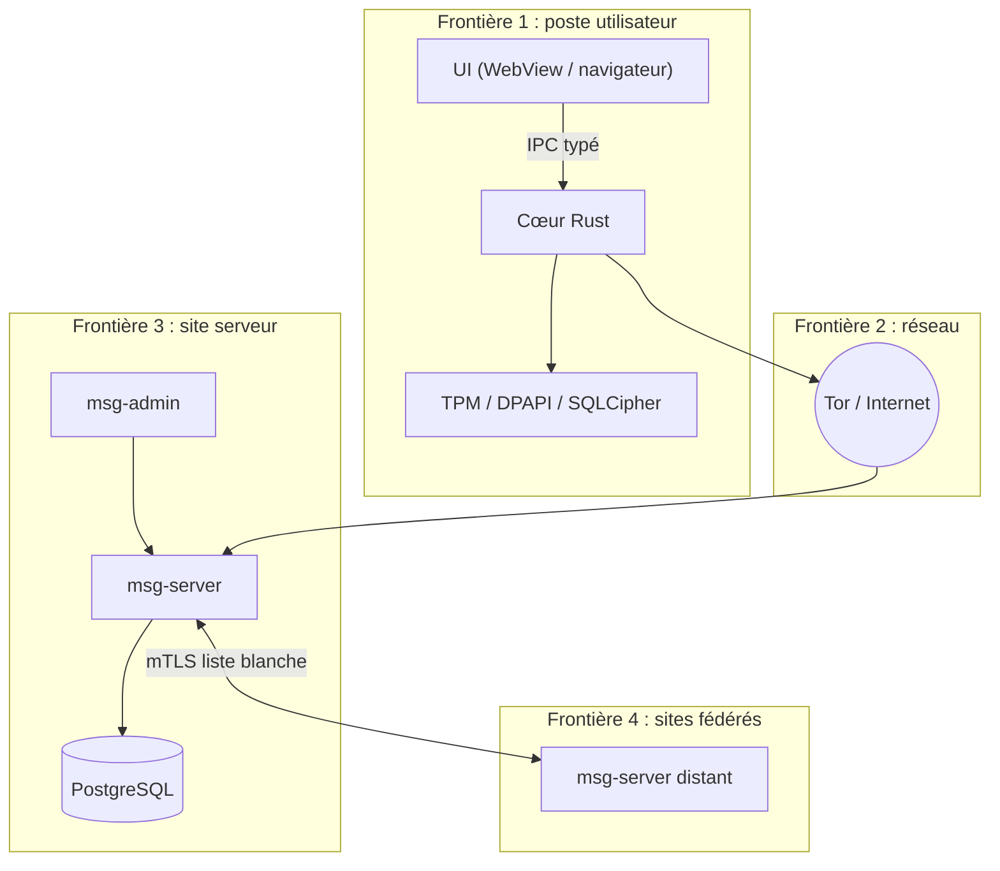

# 03 — Modèle de menace (STRIDE)

## 1. Actifs à protéger

| # | Actif | Criticité |
|---|---|---|
| A1 | Contenu des messages, pièces jointes, noms de fichiers, miniatures | Critique |
| A2 | Clés privées (identité, appareils, MLS, BDD locale) | Critique |
| A3 | Identifiants (mots de passe, secrets TOTP, passkeys) | Critique |
| A4 | Métadonnées : graphe social, horaires, IP | Élevée |
| A5 | Intégrité du logiciel client (binaire, bundle web) | Critique |
| A6 | Disponibilité du service (multi-site) | Élevée |
| A7 | Journal Key Transparency | Élevée |
| A8 | Sauvegardes serveur | Élevée (contiennent des blobs chiffrés + métadonnées) |

## 2. Adversaires

| Id | Adversaire | Capacités supposées |
|---|---|---|
| ADV-NET | Attaquant réseau (FAI, Wi-Fi public, État) | Observer, bloquer, modifier le trafic |
| ADV-SRV | Opérateur serveur malveillant ou serveur compromis | Lire/modifier BDD, logs, servir de fausses clés, servir un bundle web piégé |
| ADV-ADM | Administrateur de site malveillant | Créer/réinitialiser des comptes, révoquer des appareils |
| ADV-FED | Serveur fédéré (de la liste blanche) compromis | Injecter du trafic de fédération, mentir sur ses utilisateurs |
| ADV-DEV | Accès physique / maliciel sur un poste | Voler le disque, lire la mémoire, capturer l'écran |
| ADV-USR | Utilisateur légitime malveillant | Exfiltrer, spammer, envoyer des fichiers piégés |
| ADV-SC | Chaîne d'approvisionnement | Dépendance piégée, CI compromise |

**Hors périmètre** (documenté, non traité) : maliciel avec privilèges noyau/administrateur sur le poste déverrouillé ; adversaire global passif capable de corréler tout le trafic Tor ; coercition de l'utilisateur.

## 3. Frontières de confiance

## 4. Analyse STRIDE par composant

Légende statut : ✅ traité · ⚠️ partiellement (limite documentée) · ❌ non traitable

### 4.1 Client desktop

| STRIDE | Menace | Contre-mesure | Phase | Statut |
|---|---|---|---|---|
| S | Faux serveur (DNS/TLS) | Épinglage de clé TLS + adresse .onion | 1/3 | ✅ |
| S | Usurpation d'un contact via fausse clé | KT + QR + alerte changement de clé | 2/3 | ✅ |
| T | Binaire modifié | Authenticode + auto-vérification au démarrage + attestation SLSA | 5 | ⚠️ un attaquant capable de réécrire le binaire peut aussi retirer la vérification |
| T | Modification de la BDD locale | SQLCipher (HMAC par page) | 1 | ✅ |
| T | Injection via Markdown / HTML | AST restreint, aucun `innerHTML`, CSP stricte WebView | 1 | ✅ |
| T | Fichier image piégé (exploitation décodeur) | Décodage en Rust (mémoire sûre), limites de taille/dimensions | 2 | ✅ |
| R | Contestation d'un message | Signature MLS de chaque message (non-répudiation *interne au groupe* seulement) | 1 | ⚠️ voulu : pas de preuve transférable à un tiers |
| I | Vol du disque | SQLCipher, clé scellée TPM/DPAPI (+ mot de passe optionnel) | 1/2 | ✅ |
| I | Dump mémoire | `zeroize`, durée de vie minimale des secrets | 1 | ⚠️ ne protège pas contre un maliciel actif pendant l'usage |
| I | Capture d'écran | `WDA_EXCLUDEFROMCAPTURE` | 2 | ⚠️ inefficace contre appareil photo, capture matérielle, pilotes noyau |
| I | Aperçu dans les notifications | Notifications sans contenu | 1 | ✅ |
| I | Pixels de suivi / contenus distants | Aucun chargement d'URL externe ; CSP `default-src 'self'` | 1 | ✅ |
| I | Fuite IP | Tor strict | 3 | ✅ (desktop) |
| D | Flood de messages | Limitation côté serveur + quotas | 1 | ✅ |
| E | XSS → accès aux commandes IPC | Liste blanche de commandes Tauri (capabilities v2), aucune commande n'exporte de clé | 1 | ✅ |

### 4.2 Client web

| STRIDE | Menace | Contre-mesure | Statut |
|---|---|---|---|
| T/E | **Serveur livrant un JS piégé** | SRI, CSP, bundle signé publié en Release + empreinte affichée ; recommandation : héberger le client web séparément du serveur de messages ; extension de vérification envisagée | ❌ **non résolu par nature** (voir limites) |
| I | XSS → vol des clés en mémoire WASM | CSP stricte, Trusted Types, aucun HTML brut, dépendances minimales | ⚠️ |
| I | Clés dans IndexedDB | Chiffrées sous une clé dérivée du mot de passe (Argon2id) | ⚠️ attaque hors-ligne possible si mot de passe faible |
| I | Capture d'écran | Filigrane, flou à la perte de focus | ❌ non empêchable |
| I | IP | Tor Browser + .onion | ⚠️ dépend de l'utilisateur |

### 4.3 Serveur

| STRIDE | Menace | Contre-mesure | Statut |
|---|---|---|---|
| S | Vol de mot de passe | Argon2id, TOTP/passkey obligatoires (configurable), limitation de débit, verrouillage progressif | ✅ |
| S | Rejeu de jetons | Jetons courts liés à l'appareil + requêtes signées avec nonce | ✅ |
| T | Serveur modifie des messages | AEAD + signatures MLS → détecté par le client | ✅ |
| T | Serveur sert de fausses clés (MITM) | KT (`akd`) + audit + QR | ✅ (détection) |
| T | Serveur réordonne/supprime des commits | Règles MLS (époques) ; suppression = déni de service détectable | ⚠️ |
| R | Action admin niée | Journal d'audit admin signé, append-only | ✅ |
| I | Lecture BDD | Blobs chiffrés ; secrets TOTP chiffrés au repos (clé hors BDD) | ✅ |
| I | Métadonnées (qui parle à qui) | Expéditeur chiffré dans MLS, padding, rétention minimale, aucun log d'IP | ⚠️ graphe de routage visible |
| I | Métriques qui fuient | Aucun label utilisateur/conversation dans Prometheus ; test automatisé | ✅ |
| D | DoS | Rate-limit, quotas, HA multi-instance, Onionbalance | ⚠️ DoS volumétrique hors périmètre applicatif |
| E | Admin s'octroie l'accès aux messages | Impossible cryptographiquement : réinitialiser un compte crée une **nouvelle** identité → alerte chez tous les contacts | ✅ |
| E | Injection SQL | `sqlx` requêtes paramétrées vérifiées à la compilation | ✅ |

### 4.4 Fédération

| STRIDE | Menace | Contre-mesure | Statut |
|---|---|---|---|
| S | Serveur non autorisé | mTLS + clé publique épinglée par site (liste blanche) | ✅ |
| S | Site A usurpe des utilisateurs du site B | Un site ne peut annoncer que des identités de son domaine ; vérif. KT croisée | ✅ |
| T | Site relais modifie les messages | Chiffrement de bout en bout (le relais ne voit que des blobs) | ✅ |
| D | Site injoignable | File store-and-forward persistante avec ré-émission | ✅ |
| I | Site fédéré compromis apprend des métadonnées | Seules les métadonnées de routage nécessaires sont échangées | ⚠️ |

### 4.5 Chaîne d'approvisionnement / CI

| Menace | Contre-mesure | Statut |
|---|---|---|
| Dépendance malveillante | `cargo-deny`, `cargo-audit`, `cargo-vet` (optionnel), `pnpm audit`, Dependabot, lockfiles commités | ⚠️ |
| Action GitHub compromise | Actions épinglées par SHA, `permissions:` minimales, `harden-runner` envisagé | ✅ |
| Vol de la clé de signature | Signature dans un *Environment* protégé, idéalement HSM cloud (Azure Artifact Signing / SignPath) — jamais de `.pfx` dans le dépôt | ✅ |
| Binaire publié non issu du code | Attestations de provenance SLSA (Sigstore) + checksums | ✅ |

## 5. Risques résiduels principaux (synthèse)

1. **Client web** : la confiance dans le serveur qui livre le code est inévitable.
2. **Métadonnées de routage** visibles par le serveur de chaque site.
3. **Poste compromis** pendant l'usage = messages compromis (vrai pour toute messagerie).
4. **Implémentations non auditées** : OpenMLS et la suite X-Wing n'ont pas (à notre connaissance) d'audit public complet ; à re-vérifier avant production.
5. **Administrateur** : peut nier le service (suspension) ou réinitialiser un compte (visible par tous les contacts) mais ne peut pas lire.
