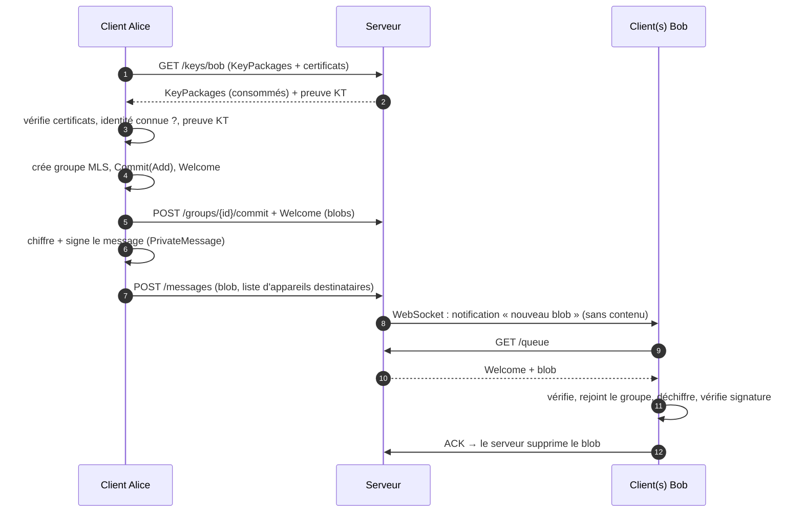
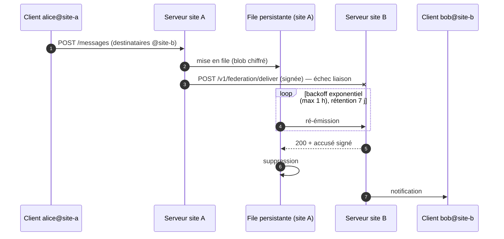
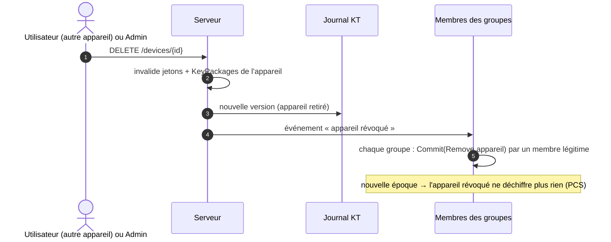
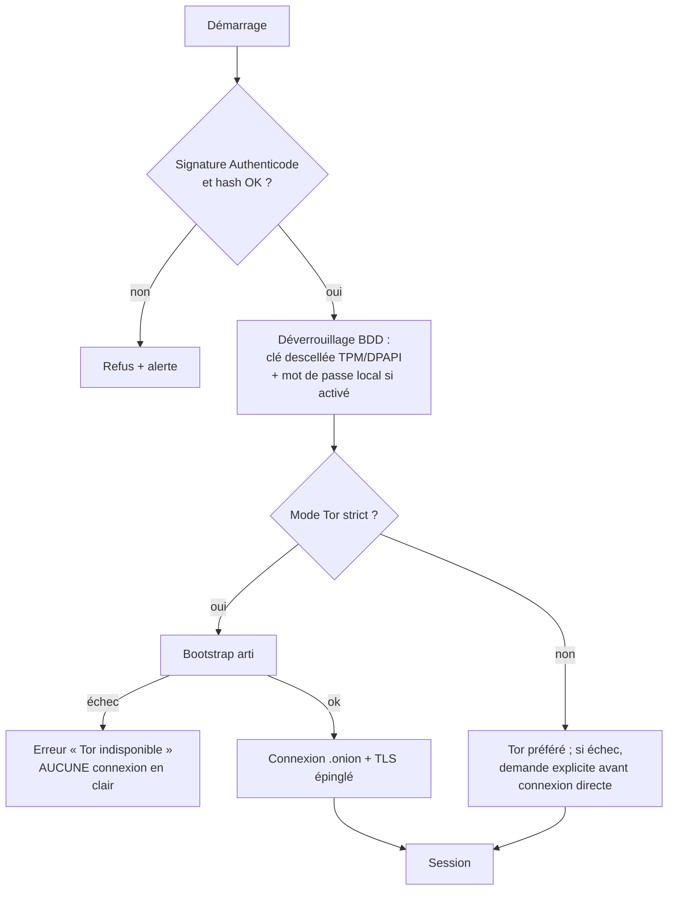
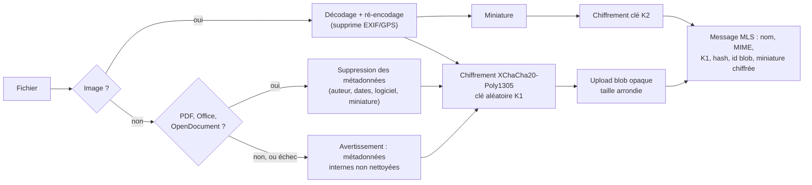

# 04 — Schémas de flux

## 1. Création de compte par un administrateur et première connexion

```mermaid
sequenceDiagram
  autonumber
  actor Admin
  participant CLI as msg-admin
  participant S as msg-server
  actor U as Utilisateur
  participant C as Client (desktop/web)

  Admin->>CLI: account create alice --role user
  CLI->>S: POST /admin/accounts (jeton admin + TOTP)
  S-->>CLI: code d'activation à usage unique (expire 72 h)
  Admin-->>U: remet le code hors bande
  U->>C: identifiant + code d'activation + nouveau mot de passe
  C->>S: POST /auth/activate
  S->>S: Argon2id(mot de passe) ; code invalidé
  S-->>C: secret TOTP (URI otpauth://)
  U->>C: saisit le code TOTP
  C->>S: POST /auth/totp/confirm
  C->>C: génère clé d'identité + appareil + KeyPackages (local)
  C->>S: POST /devices (certificat d'appareil, KeyPackages publics)
  S->>S: publie (alice → identité, appareils) dans le journal KT
  S-->>C: jetons de session (accès 15 min / refresh)
```

L'administrateur ne connaît jamais le mot de passe final ni aucune clé privée.

## 2. Envoi d'un message 1-à-1 (nouvelle conversation)



## 3. Fédération inter-sites avec perte de liaison



## 4. Révocation d'un appareil compromis



## 5. Démarrage du client desktop (mode Tor strict)



## 6. Pièce jointe


