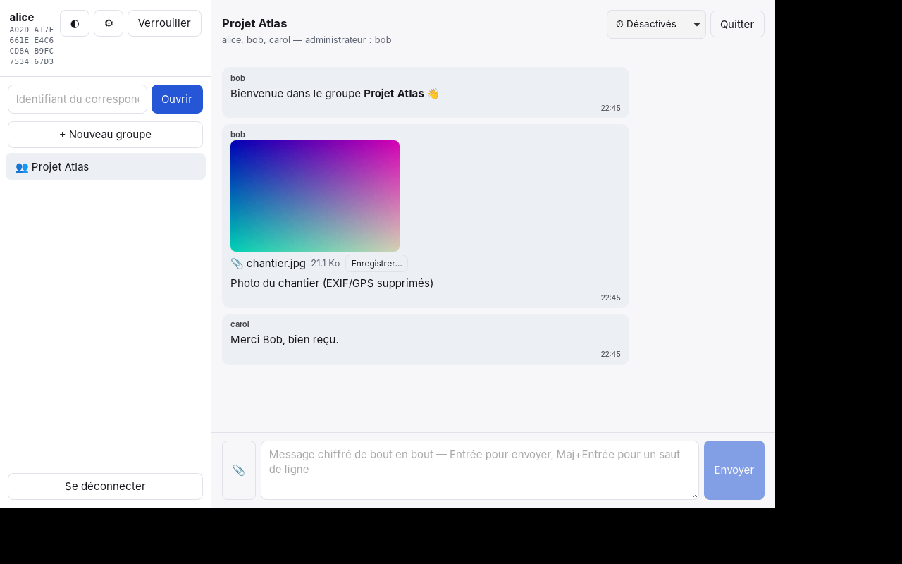
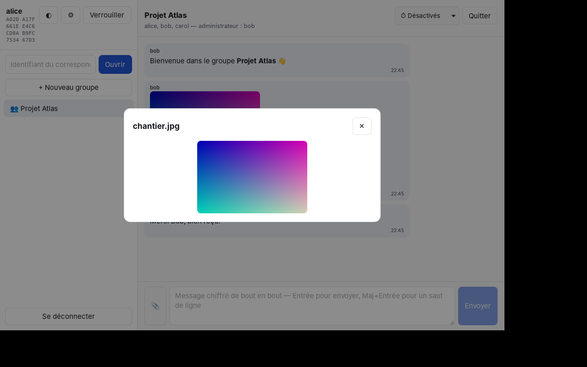
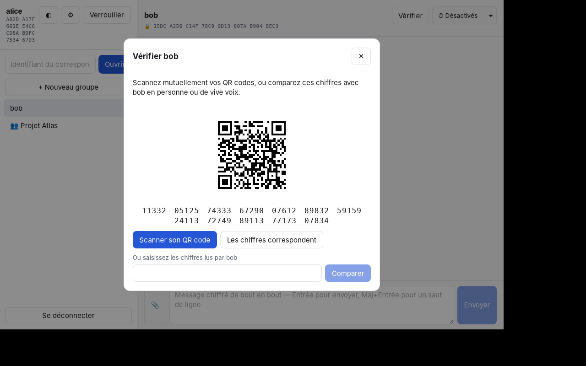
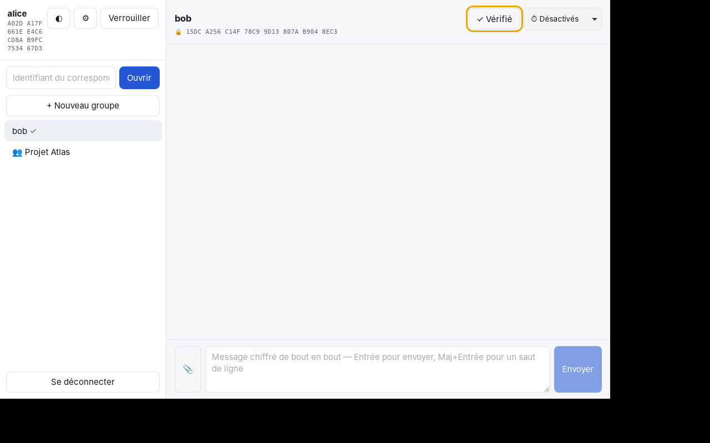

# Phase 2 — Sécurité avancée : rapport de livraison

> Statut : **livrée, en attente de validation.**

## 1. Périmètre

| Exigence Phase 2 | État | Où |
|---|---|---|
| Groupes MLS multi-utilisateurs (création, ajout, retrait, départ) | ✅ | `crates/msg-crypto/src/mls.rs`, `crates/msg-client-core/src/conversations.rs` |
| Ordonnancement des commits sans fourche (un seul « committer » par groupe) | ✅ | ADR-0012 |
| Pièces jointes chiffrées, **EXIF/GPS supprimés** par ré-encodage | ✅ | `crates/msg-media`, `crates/msg-crypto/src/attachment.rs` |
| **Noms de fichiers et miniatures chiffrés** (dans le message MLS) | ✅ | `crates/msg-client-core/src/attachments.rs` |
| Vérification d'identité par **QR code** et numéro de sécurité (60 chiffres) | ✅ | `crates/msg-crypto/src/safety.rs`, `ui/src/components/SafetyDialog.tsx` |
| **Détection et alerte** des changements de clé (conversation suspendue) | ✅ | `conversations.rs` (`check_identity`, `refresh_identity_status`) |
| **Messages éphémères** / suppression programmée | ✅ | `AppMessage.expires_in_s`, `LocalStore::purge_expired` |
| **Rotation automatique** des clés (7 jours / 100 messages) | ✅ | `Client::rotate_due` |
| **Anti-capture** (`WDA_EXCLUDEFROMCAPTURE`, repli `WDA_MONITOR`) | ✅ (Windows) | `crates/msg-platform-win/src/capture.rs` |
| **Verrouillage automatique** après inactivité (1 à 240 min, 5 par défaut) | ✅ | `apps/desktop/src-tauri/src/lib.rs` (`auto_lock`) |
| **Passkeys / FIDO2 / YubiKey** (second facteur à la place du TOTP) | ✅ | `server/msg-server/src/routes/webauthn.rs`, `crates/msg-client-core/src/passkey.rs`, `crates/msg-platform-win/src/webauthn.rs` |
| **TPM** : clé de la base locale scellée par le TPM (CNG), repli DPAPI | ✅ (Windows) | `crates/msg-platform-win/src/tpm.rs`, `crates/msg-client-core/src/vault.rs` |
| Notifications **sans aperçu** | ✅ | `sync_and_emit` (ni expéditeur, ni contenu) |

## 2. Fichiers créés ou modifiés

```
crates/msg-crypto/src/{safety.rs, attachment.rs}            nouveaux
crates/msg-crypto/src/{mls.rs, app_message.rs}              groupes, propositions, politique de commit, nouveaux types
crates/msg-media/                                           nouveau crate (ré-encodage d'images, miniatures)
crates/msg-client-core/src/{conversations.rs, attachments.rs, passkey.rs}   nouveaux
crates/msg-client-core/src/{client.rs, store.rs, vault.rs, api.rs}         schéma local v2 (migration), TPM, API
crates/msg-platform-win/src/{capture.rs, tpm.rs, webauthn.rs}              nouveaux (FFI Win32 isolée)
crates/msg-proto/src/lib.rs                                 types WebAuthn et pièces jointes
server/msg-server/migrations/{0002_attachments.sql, 0003_webauthn.sql}
server/msg-server/src/routes/{attachments.rs, webauthn.rs}  nouveaux
server/msg-server/src/{routes/account.rs, auth.rs, config.rs, state.rs, tasks.rs}
server/msg-server/tests/e2e.rs                              4 nouveaux scénarios
apps/desktop/src-tauri/                                     30 commandes, plugins notification + dialogue
ui/src/components/{Modal, QrScanner, SafetyDialog, GroupDialog, SettingsDialog, AttachmentView}.tsx
ui/src/{App.tsx, views/Chat.tsx, views/Auth.tsx, api/*}
ui/tests/{mockBackend.ts, Phase2.test.tsx}
docs/adr/0012-committer-unique.md, docs/phases/phase-2.md, guides mis à jour
```

## 3. Tests

| Suite | Nombre | Nouveautés Phase 2 |
|---|---|---|
| `msg-crypto` | 28 | groupes (ajout, retrait → membre retiré incapable de déchiffrer, propositions validées par l'administrateur, **commit non autorisé rejeté sans changer l'état**, départ), numéros de sécurité (symétrie, sensibilité à la clé et au nom, QR), pièces jointes (remplissage par paliers, intégrité, mauvaise clé) |
| `msg-media` | 6 | **marqueur GPS EXIF absent après nettoyage**, blocs `tEXt` PNG supprimés, fichiers corrompus refusés, **bombe de décompression refusée**, miniature bornée |
| `msg-client-core` | 12 | **migration d'une base de Phase 1**, clé d'identité en attente, expiration, sélection des rotations, noms de fichiers dangereux (`../../`, `C:\…`), **rpId étranger refusé** avant tout appel à l'authentificateur |
| `msg-server` (bout en bout) | 9 | voir ci-dessous |
| `msg-platform-win` | 1 (+1 sous Windows) | DPAPI réel ; TPM réel si présent sur la machine de CI |
| `messagerie-desktop` | 3 | QR local, erreurs, authentificateur natif hors Windows |
| UI (Vitest) | 24 | groupes, bandeau de changement de clé, vérification (discordance signalée), pièces jointes (aucune image distante), envoi de fichier, éphémères, verrouillage automatique, connexion par clé |

Nouveaux scénarios de bout en bout (serveur réel, PostgreSQL, clients réels) :

1. **`identity_change_suspends_until_verified`** — après réinitialisation du compte de Bob, la conversation chez Carol est suspendue (contenu masqué, envoi refusé), le numéro de sécurité porte sur la nouvelle clé et est **identique des deux côtés** ; un mauvais QR est refusé, le bon rétablit la conversation et affiche le message en attente.
2. **`group_lifecycle`** — groupe à 3 puis 4 membres ; seul l'administrateur gère les membres ; **un membre retiré ne reçoit plus rien** ; départ par proposition validée automatiquement.
3. **`ephemeral_messages_and_key_rotation`** — expiration chez l'expéditeur et le destinataire ; rotation par proposition d'un membre puis par commit de l'administrateur, conversation toujours fonctionnelle.
4. **`attachments_are_cleaned_and_encrypted`** — photo JPEG avec EXIF GPS : nom de fichier, type MIME, légende et marqueur **absents de toutes les tables du serveur** ; le destinataire reçoit une image valide **sans EXIF** ; fichier PDF transmis intact et signalé « non nettoyé ».
5. **`passkey_second_factor`** — authentificateur FIDO2 logiciel (ES256, format CTAP2 « none ») face au vrai `webauthn-rs` : enregistrement, connexion **sans TOTP**, défi refusé sans mot de passe correct, **signature altérée rejetée par le serveur**, clé inconnue refusée, suppression effective.

**Essai réel de l'application** (Linux, WebKitGTK, écran virtuel, serveur réel) : groupe créé par Bob avec Carol et Alice, photo reçue avec miniature locale, aperçu plein écran via IPC binaire et URL `blob:` (CSP stricte), panneau de sécurité, vérification du numéro de sécurité (contact marqué ✓).






## 4. Commandes

Inchangées (voir [rapport de Phase 1](phase-1.md#4-commandes)). Nouvelles variables serveur : voir le
[guide de développement](../guides/developpement.md#variables-du-serveur) (`MSG_WEBAUTHN_RP_ID`,
`MSG_WEBAUTHN_ORIGIN`, `MSG_ATTACHMENT_RETENTION_SECS`, `MSG_ATTACHMENT_QUOTA_BYTES`).

## 5. Écarts par rapport à la conception

| Écart | Raison | Trace |
|---|---|---|
| Un seul membre (l'administrateur) émet les commits MLS ; les autres proposent | Le serveur n'ordonne pas les commits : sans cette règle, deux commits simultanés créent une fourche d'époque | ADR-0012 |
| Pièces jointes : AEAD en un seul bloc (≤ 25 Mio) au lieu de STREAM par blocs de 64 Kio | Simplicité ; la taille maximale tient en mémoire | `attachment.rs` |
| Pièces jointes stockées dans PostgreSQL (`BYTEA`) | Pas de stockage objet en Phase 2 ; S3 auto-hébergé envisagé en Phase 4 | `0002_attachments.sql` |
| `webauthn-rs` 0.6 (sans OpenSSL) au lieu de 0.5 | Image serveur sans bibliothèque native | — |

## 6. Limites et risques connus

**Sécurité**

1. **Aucun audit externe** (inchangé). Le code FFI Windows (`webauthn.dll`, TPM CNG, affichage)
   est **vérifié par compilation contre les déclarations officielles** et exécuté en CI Windows
   pour DPAPI, mais **les cérémonies YubiKey, le scellement TPM et l'anti-capture n'ont pas pu être
   testés sur un vrai poste** : voir la [recette Windows](../guides/recette-windows.md).
2. **Anti-capture** : inefficace contre un appareil photo, une carte d'acquisition, un logiciel
   malveillant noyau ; selon la configuration, le Bureau à distance peut afficher la fenêtre.
3. **Messages éphémères** : un destinataire peut toujours photographier l'écran ou utiliser un
   client modifié. Le délai court à partir de la **réception** sur chaque appareil : un appareil
   longtemps hors ligne affichera donc le message plus tard que les autres. Le serveur, lui, ne
   connaît pas le délai (il est chiffré) et supprime le blob dès sa distribution.
4. **Pièces jointes non images** (PDF, Office, vidéo) : **métadonnées internes non nettoyées**
   (auteur, logiciel, historique). L'interface l'indique. *(Levée après la Phase 5 pour les PDF,
   documents Office et OpenDocument : voir le [protocole](../conception/02-protocole-crypto.md#10-pièces-jointes).)*
5. **Administrateur de groupe unique** : s'il disparaît, le groupe ne peut plus évoluer
   (ajout, retrait, rotation) ; il ne peut pas quitter son groupe. Transfert d'administration et
   ordonnancement des commits par le serveur : Phase 4.
6. **Révocation d'un membre « hors ligne »** : le retrait est cryptographiquement effectif dès
   le commit, mais un appareil retiré conserve les messages reçus avant.
7. **Passkeys** : second facteur **en plus** du mot de passe (pas de connexion sans mot de passe) ;
   elles ne protègent pas les clés E2EE. Sur Windows, l'application native peut demander une
   assertion pour tout `rpId` : nous l'épinglons au domaine du serveur configuré, mais un poste
   compromis pourrait contourner ce contrôle.
8. **TPM** : protège contre le vol du disque ; **pas** contre un maliciel exécuté dans la session
   de l'utilisateur pendant que l'application est déverrouillée. Si la puce est réinitialisée
   (mise à jour du BIOS, changement de carte mère), la base locale devient **illisible** :
   sauvegarde/restauration chiffrée prévue en Phase 4.
9. **État MLS en mémoire non effacé** (`openmls_memory_storage`) : inchangé depuis la Phase 1 ;
   le verrouillage libère la mémoire mais sans garantie d'écrasement.
10. **Scan QR par caméra** : dépend de l'autorisation caméra de WebView2 ; non testable dans cet
    environnement. Repli : comparaison des chiffres.
11. **Trois avis de sécurité tolérés** (justifiés dans `deny.toml`) : RUSTSEC-2026-0387,
    RUSTSEC-2026-0459 (Phase 1) et **RUSTSEC-2023-0071** (`rsa` via `webauthn-rs`, vérification
    de signatures publiques uniquement).

**Fonctionnel**

12. Toujours **un seul appareil par utilisateur** (liaison d'appareils : Phase 3).
13. Pas d'accusés de lecture ni d'indicateur de saisie (choix de minimisation des métadonnées).
14. Taille maximale d'un groupe : 50 membres ; d'une pièce jointe : 25 Mio.
15. Les liens Markdown restent non cliquables.

**Livraison**

16. Binaires toujours **non signés** (Authenticode, Phase 5).
17. Recette manuelle Windows à faire : la CI construit et teste, mais ne peut pas brancher une
    YubiKey ni vérifier visuellement l'anti-capture.
